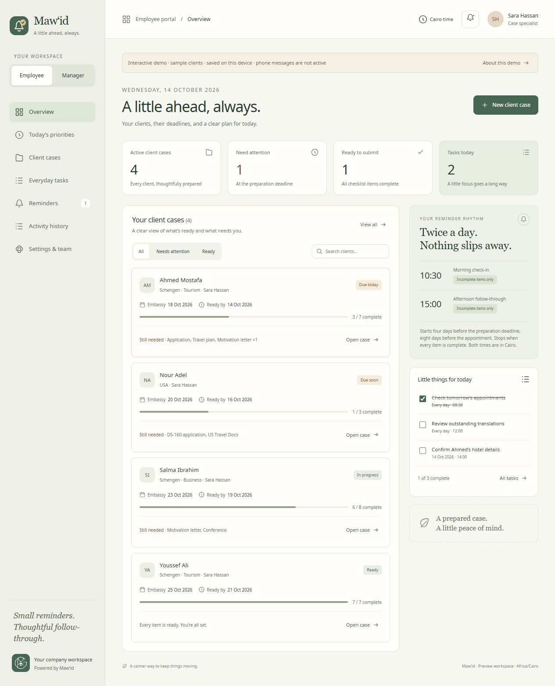

# Mawid

**A little ahead, always.** A light, calm reminder workspace for company consultations, visa preparation, everyday tasks, and exceptional tasks. Built with ivory, sage, and restrained terracotta. The existing MG company logo is preserved; the new bell/check mark identifies the reminder app.

## What is ready

- An interactive, responsive preview that starts with no clients, consultations, or tasks. Consultant and Process workspaces can be explored without signing in. Preview changes stay in the browser and do not send messages. The static preview opens on the login screen; real signup/login require the local or deployed Worker backend.
- A Cloudflare Workers/D1 backend with registration, manager-approved employee membership, login, account security controls, assigned records, encrypted browser push, and scheduled reminders.
- Included workflows: **Today’s priorities**, **consultation-to-employee-case handoff**, and **activity history**.
- An installable PWA manifest, phone icons, and a service worker that handles incoming pushes even when the tab is closed.
- Deployment instructions below. Real hosting/database/phone delivery are **not activated** by opening the static demo.

Read the [feature plan](docs/FEATURE_PLAN.md), [security review](docs/SECURITY_REVIEW.md), and [delivery report](docs/DELIVERY_REPORT.md). The feature plan was committed before implementation. The review documents confirmed fixes and remaining limits; it is not a claim that every possible vulnerability has been eliminated.



## Accounts and the new workflows

The top-right profile menu provides **Sign out** and **Upload a photo**. JPG, PNG, and WebP files up to 10 MB are resized into a 512-pixel square avatar (up to 128 KB), then saved privately in the account database. Photos persist across sign-ins and can only be fetched by their account owner. Migration 0006 adds photo storage; apply migrations before deploying this version. Process staff see only their Process workspace; consultants see only their Consultant workspace; administrators can switch between both.


Staff can choose **Create an account** and sign in with their email and password. Accounts with an assigned username can also use it in the Email or username field; email and username aliases share the same sign-in attempt limit. New accounts choose Consultant or Process and start pending, with no company-data access. Both are ordinary staff accounts; only administrators (the stored `manager` role) manage the team. A manager must verify the real staff member and approve membership in **Settings & team**. Registration does not verify email ownership or allow someone to make themselves a manager. Pending users can inspect their account security and approval state.

Managers can also create staff accounts directly. Those staff must replace their initial password before company records become available. **Account security** supports password changes, viewing/revoking sessions, disconnecting notification devices, and hiding client details in phone previews. Password changes disconnect other sessions and all push devices; reconnect notifications afterward. Pausing employee access revokes sessions and stops their reminders. New passwords require 15–128 characters.

- **Today’s priorities** brings incomplete preparation, follow-ups, and tasks into an ordered view. Each record can have Normal, High, or Urgent priority. The dates follow Cairo time and employees see assigned work only.
- **Hand off to employee** creates one case from a consultation, assigns an active employee, starts reminders seven days before the appointment, and stops repeating consultation reminders in one transaction. Retrying does not create duplicate cases. Private consultation notes stay in the consultation; the form provides a separate employee note.
- **Activity history** shows successful checklist, deadline, assignment, status, and account changes with the actor and Cairo time. Employees see history for currently assigned records plus their own account events. Managers oversee the company. Audit summaries exclude passwords, tokens, device endpoints, and free-form notes.

## Recommended free stack

| Part | Choice | Reason |
| --- | --- | --- |
| Interface | Small JavaScript web app / PWA | Runs on desktop and phone; no app-store subscription |
| Hosting and API | Cloudflare Workers + Static Assets | One deployment for the app, API, and scheduler |
| Database | Cloudflare D1 / SQLite | Staff accounts, assigned cases, tasks, and notification history |
| Scheduling | Cloudflare Cron Triggers | Runs on the server while all browsers are closed |
| Phone delivery | Standards-based Web Push / VAPID | No SMS or WhatsApp message charges |

This can fit the free tier for a small company. Free quotas are limits, not an unlimited service guarantee. At the time checked, Workers Free includes 100,000 requests/day and D1 includes 5 million row reads/day, 100,000 row writes/day, and 5 GB total storage. A custom domain is optional and may cost money. See [Workers limits](https://developers.cloudflare.com/workers/platform/limits/), [D1 pricing](https://developers.cloudflare.com/d1/platform/pricing/), and [Cron Triggers](https://developers.cloudflare.com/workers/configuration/cron-triggers/).

### Notifications with the website closed

These use server-sent push and a service worker, not timers in an open webpage. [MDN explains receiving push while an app is not loaded](https://developer.mozilla.org/en-US/docs/Web/API/Push_API).

- Android: Chrome/Edge with site notifications allowed. Installing the PWA is useful but is not a prerequisite on all supported Android browsers.
- iPhone/iPad: add the app to the Home Screen, open that installed app, and allow notifications. Supported on iOS/iPadOS 16.4 and later; see [WebKit’s explanation](https://webkit.org/blog/13878/web-push-for-web-apps-on-ios-and-ipados/).
- Desktop: supported Chrome, Edge, Firefox, or Safari with permission granted. Browser background behavior and OS settings vary.

Closing the **website tab** is supported. Delivery cannot be guaranteed if the browser is force-stopped, notifications are blocked, the phone is offline, or Focus/battery settings suppress them. The delivery history records push-service acceptance, not proof that a person saw the notification. There is no dependable universal free SMS/WhatsApp production option assumed here.

## Reminder rules

### Consultant workspace

Record client name, consultation date, recommended destination, assigned consultant, and notes. Consultants see and edit their own consultations only; administrators can oversee all consultations. The interface shows how many days have passed since the consultation.

- Default interval: 48 hours.
- Custom interval: 1–720 hours, or choose the exact next reminder in Cairo time.
- The first reminder defaults to consultation day at 10:30 plus the chosen interval. Enter an exact next time when a different anchor is needed.
- “Followed up today” records the contact and schedules the next interval from now.
- Snooze 24 hours, mark “Moved forward” or “Closed,” or archive to stop follow-ups.
- Notifications go to the assigned consultant, not to the client. Consultants can hand off their own consultation to an active Process employee without gaining access to that employee’s file.

### Process workspace

| Destination / purpose | Checklist |
| --- | --- |
| Schengen tourism | Hotel, Flight, Application, Aman, Travel plan, Motivation letter, Translation |
| Schengen business | Same seven items, plus Conference |
| USA | Hotel, DS-160 application, US Travel Docs |
| Canada and UK | Under processing; case tracking only, no unspecified checklist |

“Aman” is kept exactly as supplied in the brief. Confirm its internal meaning before renaming it.

- File deadline = the embassy appointment date. The countdown uses this date, without an additional four-day preparation deadline.
- Default reminder start = embassy appointment minus **seven calendar days**.
- Creating a case automatically enrolls its reminders seven days before the appointment. There is no manual start-date field; changing the appointment automatically moves the reminder schedule. All editable and displayed dates use DD/MM/YYYY; the database stores ISO dates.
- Reminders run daily at **10:30 and 15:00, Africa/Cairo**.
- Messages show the appointment countdown, completed steps, remaining steps, and the next suggested step. They explicitly say when no preparation has been completed.
- Suggested Schengen order: Translation → Hotel → Flight → Aman → Travel plan → Motivation letter → Application. Business includes Conference after Translation. These are suggestions based on the company checklist, not enforced dependencies; staff can tick items in any order.
- Existing checklist items, including Aman, are preserved. Spain uses the shared Schengen checklist.
- Reminders continue after the appointment until the file is complete or archived. Moving the appointment recalculates the default start; the reminder schedule always follows the new appointment date.
- Fully checked files stop preparation reminders. Canada/UK remain tracking-only until their checklists are defined.

Example: appointment **15 November 2026** → default reminders start **8 November**. On 9 November, an untouched file says “6 days left until the embassy appointment” and “No preparation steps completed yet.” On 11 November, if Hotel and Flight are checked, it says “4 days left,” “Completed: Hotel, Flight,” lists the remaining items, and suggests Translation next.

### Everyday and exceptional tasks

Each task has an owner, time, date, and daily or one-off frequency. Daily completion resets on the next Cairo calendar day. One-off completion remains complete. Both can create push notifications. Cairo time is calculated with `Intl`, including daylight-saving changes; follow-up intervals remain elapsed hours.

## Run locally

Requires Node.js 24 or later for the built-in SQLite tests.

Run the actual application with working signup/login and an initially empty local database:

```powershell
npm ci
npm run auth:key
npm run db:local
npm run dev
```

Open `http://127.0.0.1:8787`. Run `auth:key` only once: it saves private, ignored local files and preserves an existing key. New Consultant/Process accounts await administrator approval. To initialize the first local administrator with your own credentials, run `npm run create-manager`, apply `bootstrap-manager.sql` using `npx wrangler d1 execute mawid --local --file bootstrap-manager.sql`, then delete that generated SQL file. Never share your password in chat.

For a static interface preview only, run `npm run preview` and open its printed URL. It starts with empty client data and uses separate browser storage from the older sample demo, so old sample cases are not loaded. Signup/login are disabled in the static preview. Use `npm.cmd` instead of `npm` if PowerShell blocks the npm script shim.

## Deploy the actual app for free

Run these from this project directory. The `.openai/hosting.json` file belongs to the private **Sites demo**; Cloudflare uses `wrangler.jsonc` for the actual application.

1. Create/use a Cloudflare account on the Free plan and sign in:

   ```powershell
   npx wrangler login
   npx wrangler d1 create mawid
   ```

2. Copy the returned `database_id` into `wrangler.jsonc`, replacing `REPLACE_WITH_YOUR_D1_DATABASE_ID`.

3. Generate and upload the account security key, then initialize the remote database and create your first manager:

   ```powershell
   npm run auth:key
   npx wrangler secret bulk auth-secrets.json
   npm run db:remote
   npm run create-manager
   npx wrangler d1 execute mawid --remote --file bootstrap-manager.sql
   Remove-Item -LiteralPath .\bootstrap-manager.sql
   ```

   The helper prompts for the manager’s name, email, and password. Password input is hidden. The SQL contains a salted, pepper-protected password hash. Use a unique password of at least 15 characters. Keep `auth-secrets.json` and `.dev.vars` private and backed up; they are ignored by Git. Losing or replacing `AUTH_PEPPER` makes upgraded passwords unverifiable. The app does not send email invitations or password-reset emails.

4. Deploy the application:

   ```powershell
   npm run deploy
   ```

   The `workers.dev` address provides HTTPS and does not require buying a domain. The first deployment can be opened and signed into before push keys are configured.

5. Generate and upload push keys:

   ```powershell
   npm run push:keys
   npx wrangler secret bulk push-secrets.json
   ```

   Enter your administrator email for the VAPID contact. Keep `push-secrets.json` and `.dev.vars` private; both are ignored by Git. The private key is a server secret. The public key is intentionally returned to signed-in browsers through `/api/config`. The key helper refuses to overwrite existing keys. Preserve the keys; changing them requires staff to subscribe again.

6. Sign in as the manager. Staff may register themselves and then wait for approval in **Settings & team**. Verify their real identity before approval because emails are not automatically verified. Alternatively use **Add staff member** and share an initial login privately; the employee must change that initial password before accessing company records.

7. On each staff phone, open/install the app and tap **Settings & team → Enable on this device**, then approve the browser/OS notification prompt. Each account supports up to three devices. Signing out turns off notifications on that browser; other subscribed phones remain connected.

8. Confirm delivery on the actual phones: create a one-off task a few minutes ahead, close the app tab, and wait for its notification. Also validate the two case-reminder times and a shortened test consultation interval. This acceptance test is still required; no real account/device subscription was available during development.

## Validation and operating limits

```powershell
npm test
npx wrangler deploy --dry-run
```

100 tests passed, covering reminder calculations, Cairo daylight-saving changes, account approval and role boundaries, peppered credentials, session revocation and limits, cross-origin/body validation, reassignment privacy, handoff transactions, history consistency, encrypted push/decryption, private previews, blocked reminders for inactive accounts, and cleanup without push configuration. `npm audit --audit-level=high` found zero reported dependency vulnerabilities. The pinned GitHub Actions workflow repeats tests, dependency auditing, and the Worker deployment dry-run.

The actual local Workers/D1 runtime was also checked for static security headers, login, authenticated reads, creating a case, checklist changes, activity, and session inspection. To repeat, first run `npm run auth:key` if `.dev.vars` has no account key, start `npm run dev` in one terminal, and run `npm run verify:local` in another. That helper creates and removes only its named local test account and records. For temporary local testing without a saved account key, supply the same synthetic 64-hex key to `wrangler dev --var AUTH_PEPPER:<test-key>` and the helper via `MAWID_VERIFY_PEPPER`; never use a synthetic test key in production. Do not enable real push keys for a synthetic test account.

Browser QA included checklist editing and message updates, both portals, date previews, search, and responsive layout. The 375px layout has no page-level horizontal overflow. The supplied Code Reviewer scripts were executed, but their analysis functions are placeholders; their “zero findings” result is not treated as a substantive audit. Manual review and the tests supply the actual verification.

The scheduler checks every five minutes, scans up to six due records, and handles up to three queued reminders per run, with up to three subscribed devices per account. This stays within small free-plan invocation budgets. Times are scheduling targets: queues, outages, push services, and device settings can delay delivery. For a larger team, measure queue depth and increase capacity with a suitable plan or queue design. It retries transient failures up to five times, records failures, removes expired device subscriptions, and remembers devices whose push services already accepted a notification.

No notification system can promise exactly-once delivery across a network failure. Saved receipts and notification tags reduce duplicates; an ambiguous failure after a push service accepted a message can still result in a retry. Superseded reminders are cancelled, and missed morning case messages are replaced by the current afternoon slot.

Staff must keep notification permission enabled. An expired subscription requires enabling notifications again. Email verification, password recovery, MFA, and isolation between unrelated companies remain future additions. Activity is append-only through the API, but database administrators can change it.

The current password derivation uses Workers-compatible PBKDF2 at 100,000 rounds plus a separate server-secret HMAC. This improves protection against a database-only leak, but is below OWASP’s 600,000-round PBKDF2 recommendation. Production CPU time and authentication costs must be measured against the free plan; use managed authentication or a suitable runtime if stronger hashing or dependable public signup capacity is required. See the [security report](docs/SECURITY_REVIEW.md) for details.

### Personal tasks and employee rank

Every active account has a private Personal tasks page: titles, notes, optional due dates in DD/MM/YYYY format, priorities, status, up to 20 subtasks, search, sorting, completion, editing, and deletion. Personal tasks are stored separately from shared work. Administrators cannot access another user’s list through the API, workspace exports, activity history, or Rank. This list has no scheduled push reminders; use Everyday tasks for scheduled shared work reminders.

Rank shows active employees for Today or This week, using Cairo calendar boundaries and Monday as the start of the week. Points: checklist completion 5, client follow-up 5 per client per day, shared task completion 3, consultation handoff 3, case/consultation creation 1, plus 1 for each day with scored work. Page views and edits earn no points; private tasks and administrator work are excluded. Repeating a completed work unit does not earn extra points; reopened checklist steps and shared tasks stop counting until completed again. Daily shared tasks can earn credit once per day. The first completion retains its original actor and date. Equal scores share the same position. Historical checklist, creation, and handoff events are recovered from server-written activity; older follow-up and task events did not contain enough structured information for reliable recovery and count from this release onward. Rank measures recorded work, not time online or work performed outside the app.

Cases now expose immutable creator metadata independently of assignment. Existing creators are recovered from creation history; missing history is shown as “Creator not recorded.” Activity shows the server-recorded actor prominently as Changed by.

### One-time Google Sheet import

The October 2026 local import uses the Tourism 2026 workbook’s Data sheet, selecting App. Month from August 2026 onward. It preserves the submitting email separately from File Holder, keeps all 20 source fields with their raw values, and retains separate rows that share an Odoo ID. Imported cases are assigned to the account matching File Holder. Employees continue to access only records assigned to their account ID; administrators retain oversight. Usernames accept file-holder names with spaces and are case-insensitive. Newly provisioned accounts require their initial password to be changed before records become accessible. Existing account passwords are preserved. Accounts without a verified contact email use an internal login alias; submitting emails remain source data and are not assumed to identify the file holder.

Missing or non-date appointment values remain unset. Completed, cancelled, and held cases retain their source lifecycle and do not send preparation reminders. Brazil and other undefined destinations support tracking without an invented checklist. The existing Schengen checklist is used for Schengen cases, with purpose preserved separately. The source has no per-step preparation history, so those marks are not guessed; a past review submission date checks Submitted to review. All source fields, including future review dates and inconsistent calendar entries, remain visible.

Source-row identity and hashes are recorded in sheet_import_rows (migration 0012). server/sheet-import.mjs validates the snapshot, maps rows, produces guarded idempotent statements, and detects changed source rows for reconciliation. Repeating the same import does not overwrite work completed in the app. Imports have their own audit action and earn no ranking points. Case lists are searchable by holder, country, name, phone, email, and Odoo ID, with 20 cases per page. This is a one-time import; no recurring Google Sheets synchronization is enabled. Source snapshots, prepared data, account hashes, and the pre-import database backup stay in ignored .wrangler/imports and are not published with application source.

### Upgrading an existing installation

Back up the database before upgrading. Apply `npm run db:remote` to an existing schema; migration 0013 preserves original record creation dates for weekly filters; migration 0012 adds source-row import identities; migration 0011 captures creator email independently of assignment; migration 0010 adds Submitted to review as the final checklist step and refreshes case scheduling; migrations 0008 and 0009 add private tasks, work credits, and historical ranking backfills; migration 0007 preserves record creators; migration 0006 adds private profile photos; migration 0005 removes manual case-start overrides and reindexes all case schedules automatically; migration 0004 adds optional unique usernames; migration 0003 adds staff workflows, moves default case starts to seven days before the appointment, preserves custom starts, and cancels queued messages from the old rules; migration 0001 uses `IF NOT EXISTS` and migration 0002 adds account state, versioned sessions, handoff links, and history. Generate/upload `AUTH_PEPPER` once before deploying this version. Preserve an existing pepper if one is already configured. Existing managers retain administrator access; existing employees remain Process staff. New consultant accounts are ordinary employees with `staff_type=consultant`. Staff select their workflow at registration, and an administrator verifies it at approval. Reassign existing client records before switching a paused staff member’s workflow. Legacy users remain active and their stored hashes upgrade on successful sign-in; existing sessions remain compatible. Do not re-run already-applied migrations manually or edit their SQL. Missing account-secret configuration deliberately blocks registration and login.

All asset requests now pass through the Worker to receive its security headers, so those requests also count against the Worker invocation allowance. [Cloudflare documents this behavior](https://developers.cloudflare.com/workers/static-assets/billing-and-limitations/).

## Project files

- `dist/`: app interface, shared date/reminder logic, service worker, manifest, and brand assets.
- `server/`: Workers API, password/session handling, D1 schema, push transport, and scheduler.
- `tests/`: scheduling, API, SQLite, encryption, and service-worker verification.
- `scripts/`: preview, initial manager, push-key generation, brand export, and local runtime verification.
- `wrangler.jsonc`: free Cloudflare deployment configuration.

The SVG logo is editable at `dist/assets/mawid-logo.svg`. The icon is `dist/assets/mawid-mark.svg`. The existing company logo is `dist/assets/company-logo.svg`. The bundled Noto Sans font retains its OFL license.
