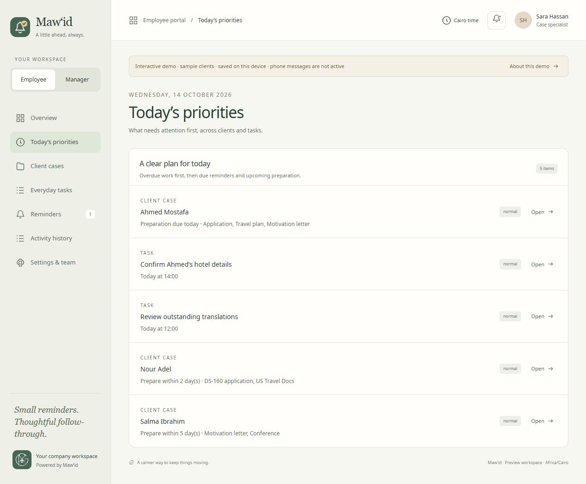
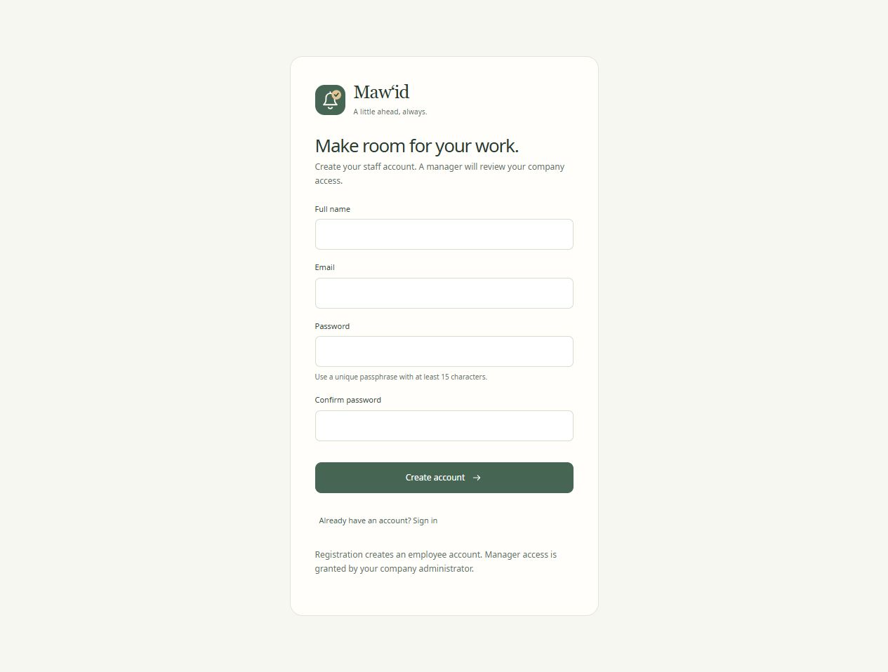

## Production deployment — 15 October 2026

Cloudflare Workers/D1 deployment: https://mawid-reminders.mgvisa-mawid.workers.dev. All 13 migrations applied. Nineteen accounts, 501 cases and 500 imported source-row identities transferred through authenticated Cloudflare APIs. Every record payload, assignment, creator field and creation date was compared with local data; usernames and password verifiers match. Browser sessions and device subscriptions were excluded. Account and VAPID secrets were uploaded privately. The cron trigger runs every five minutes. The production configuration is separated from the preserved local database binding. Live HTTPS configuration and admin sign-in returned 200; admin workspace returned all 19 people and 501 cases. A staff initial-password sign-in returned 200 with forced password change and no exposed files. All 100 automated tests still pass. This supersedes older deployment-pending notes below; real-device notification delivery still requires staff enrollment and testing.

## Case search, collapsed overview and outcome dashboard

Case cards start compact, with an accessible Overview toggle beside Open case and a reduced-motion-aware slide animation. Heading search matches client data, employee username/email, holder and Odoo ID. This week uses the original sheet submission date or immutable native creation date, in the Cairo Monday–Sunday week, excluding future entries. A separate Outcomes page shows acceptance/rejection rates among recorded decisions, with country breakdowns and authorized-record scope. Pending and cancelled cases are excluded from the rate denominator. Source spelling Accpet is recognized without changing original data.

Validation: 100 automated tests pass; the Worker deployment dry-run passes. Credential images, source-sheet files and local databases are private artifacts excluded from Git.

# Profile menu update — 15 October 2026

The profile is now a clickable, keyboard-accessible dropdown with Sign out and Upload a photo. Supported uploads are resized to a square JPEG and saved privately on the authenticated account. Migration 0006 adds persistent photo storage; another account cannot fetch the image. Process staff no longer see the Consultant option. Administrators retain both workspaces. The app, PWA, SVG logo, and push notifications consistently use Mawid without an apostrophe.

Validation: 74 tests pass, including photo persistence across sign-ins, replacement, ownership isolation, upload limits, invalid formats, and revocation races. The Worker build check passes. A temporary synthetic account verified photo upload and retrieval in the actual local Workers/D1 runtime and was removed afterward. Browser checks verified the two menu options, the new name, and Process-only navigation. Existing client records and user photos were not changed by the checks.

---

# Browser review update — 15 October 2026

All fifteen browser comments have been applied:

- MG-visa workspace branding, a Cairo-time user greeting, the requested clear-mind tagline, and a more readable page introduction. The clock label was removed from the header.
- My reminders shows actual unfinished cases, every missing checklist item, the next suggested step, and unfinished tasks/follow-ups instead of a static schedule card.
- Urgent case borders, labels, and attention markers are red. Priority deadlines and remaining work use larger, higher-contrast text. Client names and completed steps stand out in activity history.
- Date fields and displayed dates use DD/MM/YYYY with calendar validation, including consultation schedules and handoffs.
- Case reminders enroll automatically on creation and start seven days before the embassy appointment. Independent start-date controls were removed. Migration 0005 updates existing schedules while preserving client data and completed work.
- The cases page displays only created cases; generic Canada/UK placeholder tiles were removed.

Validation: 70 tests pass and the Worker deployment dry-run passes. Live browser checks verified the dashboard, case form, priority view, activity history, and rejection of an invalid date. A 15/11/2026 appointment previews automatic reminders from 08/11/2026. The existing client’s appointment and completed Hotel/Flight checks were preserved.

Production phone delivery still requires the Cloudflare/push setup described in the README.

---

# Current workflow update — 14 October 2026

The application now matches the consultation and file-preparation reminder workflow:

- Consultant and Process staff have separate workspaces and server-enforced permissions. Administrators retain team oversight. Consultants cannot read other consultants’ clients, manage staff, or edit Process files.
- A consultation on 14 October defaults to a 16 October follow-up at 10:30 Cairo time, then repeats every 48 elapsed hours while active. The exact next time remains editable.
- An embassy appointment on 15 November starts case reminders on 8 November. The appointment drives the countdown; the previous four-day preparation deadline has been removed.
- Case messages display completed and remaining checklist items, no-progress wording, and a suggested next step. Custom start previews update correctly. Notifications continue daily at 10:30 and 15:00 Cairo time until completion or archiving.
- Migration 0003 preserves accounts and explicit reminder starts, reindexes default case starts, and cancels obsolete queued messages. Apply database migrations before deploying this version.
- Existing managers retain administrator privileges; existing employees remain Process staff. Select Consultant when creating/approving new staff. Reassign existing files before switching a paused staff member’s workflow.

Validation: 65 automated tests pass, including access boundaries, own-client handoff, the exact November example, changing progress in encrypted synthetic pushes, migration preservation, Cairo DST, and service-worker delivery without an open webpage. The Worker deployment dry-run and local Workers/D1 migration/runtime verification pass. Browser checks verified default/custom reminder previews, the 14 October → 16 October consultation, checklist message changes, advancing next-step guidance, and consultant handoff. The handoff dialog closes after transfer and no client-side errors were recorded. See workflow-check.png for the updated checklist preview.

Production delivery is still pending: the local configuration contains a placeholder D1 database ID, this machine is not authenticated to Cloudflare, and no real staff devices were connected. Follow the README deployment steps and verify notification delivery on each phone with the website tab closed. The static demo sends no messages.

---

The following is the earlier delivery report, retained as historical context; its original dates and role descriptions are superseded by the update above.

# Mawid delivery — 14 October 2026

The project now includes employee signup/sign-in with manager-approved membership, account security controls, English-only app copy and branding, and the three enhancements planned in [FEATURE_PLAN.md](FEATURE_PLAN.md) before implementation. The calm ivory/sage/terracotta theme and existing MG company logo are preserved.

## Three new features

1. **Today’s priorities:** one place to open incomplete preparation, follow-ups, and daily/one-off tasks, with Normal/High/Urgent record priority and Cairo-based dates. Completed, archived, and undefined Canada/UK preparation workflows do not appear as actionable checklist work.
2. **Consultation handoff:** managers can create an assigned employee case directly from a consultation. The client name/phone and priority carry forward; manager-only notes require a separate intentional employee note. A transaction prevents duplicate cases and stops consultation reminders.
3. **Activity history:** successful changes show the actor, action, target, and Cairo time. The history is server-written and scoped to current record access; stale edits cannot create misleading success entries.

## Accounts

Create an account → sign in → wait for a manager to verify identity and approve membership. Pending users cannot view company data or select a manager role. The administrator creates the first manager using the CLI. Manager-created staff change their initial password before access.

Account security includes password changes, session/device inspection and revocation, and private phone previews. Managers can pause/reactivate employee access. No real production account or shared default password has been created.

## Security and validation

The review corrected identified privacy, logout, limiter, password-verifier, and deployment-header issues. It added regression coverage and hardened role checks, sessions, input handling, push privacy, and transactional history. **55 tests passed**, dependency auditing reported zero vulnerabilities, the actual local Workers/D1 runtime passed, and the deployment dry-run passed. Browser testing covered the complete account/approval/handoff/checklist/history workflow and phone/tablet layouts.

The full findings, evidence, and limitations are in [SECURITY_REVIEW.md](SECURITY_REVIEW.md). This is not a claim that every security weakness has been eliminated: the hashing work factor, email verification/recovery/MFA, infrastructure operations, and real-phone testing need the documented production decisions.

## What to do when you return

All application source, migrations, tests, assets, feature plans, and explanations are in [hassan-912/mawe-ed](https://github.com/hassan-912/mawe-ed). Generated secrets, local databases, synthetic account seeds, and installed dependencies are excluded from Git and the source archive. GitHub Actions verifies future pushes without deployment credentials.

The [private sample preview](https://mawid-reminder-mg.woollyberry9.chatgpt.site) uses browser-local sample data. Real accounts and closed-tab phone reminders require your Cloudflare account, D1 database, account/VAPID secrets, and actual device permission tests. Follow the [README deployment and upgrade steps](../README.md); no paid service was activated. Preserve the account security key when upgrading an existing installation.

## Personal tasks, Rank, and file holders — 15 October 2026

Added private personal to-do lists for all active accounts, daily/weekly employee ranks based on server-recorded work, creator labels in reminder cards, prominent Changed by attribution, and the Every day tasks card title. Existing case ownership, checklist progress, and client data were preserved. Migrations 0007–0009 were applied to the local app. A temporary personal task was used to verify create/edit/subtask completion/filtering/persistence and then removed. No sample client cases were added.

85 automated tests pass, including creator immutability after reassignment, handoff authorship, private task access boundaries and commit-time revocation, rank deduplication, reopened work, Cairo period boundaries, and historical ranking recovery. Worker deployment dry-run passes; the local browser confirms both pages and reminder/activity attribution. These changes are running locally at http://127.0.0.1:8787/. No production deployment or real-phone delivery was performed in this update.

## Case review and spreadsheet import preparation — 15 October 2026

Added Submitted to review as the final Schengen/USA checklist step. Existing Hotel/Flight and other preparation marks are preserved; reminders continue until preparation and review submission are complete. Overview cards and case details show the original file holder, creator email, client phone, and notes. Creator email is captured by the authenticated server and stays unchanged after reassignment. Local migrations 0010–0011 were applied; 88 tests and deployment dry-run pass.

The requested Google Sheet currently denies access to the signed-in Google account. Its August onward rows have not been read or imported. No client rows were invented or added, and no automatic sheet synchronization is enabled. The one-time import remains pending a readable source (Viewer access or an attached XLSX/CSV export); column and staff mapping must use actual source data.

## August onward import completed — 15 October 2026

After the user signed into the correct Google account, downloaded a read-only workbook snapshot and imported exactly 500 Data rows selected by App. Month from August 2026 onward. All 20 source fields on every row were reconciled against the saved database payload, with submitting email and File Holder kept separately. The existing client case was preserved, for 501 cases in the administrator view.

Created 17 additional Process accounts and reused the existing Hassan account, for 18 file-holder accounts. Usernames match holder names; case variants of Noha Amer map to one account. Differently named holders remain separate. Initial credentials are salted/peppered hashes, and new accounts require a password change at first sign-in. Existing passwords and the administrator role were preserved. No credentials or private source rows were added to Git.

Each imported record belongs to its file-holder account ID. The actual Hassan browser shows 28 total cases (27 imported plus the existing case), and searching for another holder returns none. Automated API coverage rejects cross-owner edits and confirms that creator email does not grant access to a different holder’s case. Administrator API verification confirms all 501 cases and 18 staff accounts.

320 imported cases have a usable exact appointment date; 180 do not. Empty or descriptive appointment values were preserved in source details without fabricated deadlines. Source lifecycle yields 275 active, 173 completed, 21 on hold, and 31 cancelled imported cases. Completed/held/cancelled cases do not generate preparation messages. Review marks reflect past submission dates; individual preparation marks were not invented.

96 automated tests pass and Worker deployment dry-run passes. Browser checks confirm all 20 fields on an imported overview card, own-client filtering, search, and 20-per-page navigation. Source data and a pre-import SQL backup are private in ignored .wrangler/imports. The source Google Sheet was not edited. This import is local and one-time; recurring sync remains future work.
